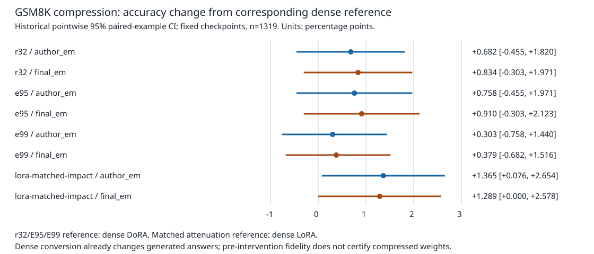

> Redacted export for reading and discussion. This export is not byte-identical to canonical inputs: local source paths are replaced and operational context is omitted. Raw validation and provenance records remain local-only and are excluded; their checks have not been rerun for this export. Scientific estimates are preserved. See the export README.

# Промежуточный разбор готовых LoRA/DoRA checkpoints

**Остановлено по просьбе пользователя 11 октября 2026. Это незавершённый
синтез этапов Q/C, а не финальный отчёт исследования.** Точная точка продолжения
и итог всего пайплайна: [CHECKPOINT.md](../CHECKPOINT.md). Локализации ещё не
приняты; математический аудит T сохранён отдельно и не интегрирован полностью.

Научный анализ существующей кампании, 11 октября 2026. Основной вопрос:
какие компоненты конечной DoRA нужны для её качества и насколько описание
геометрии весов объясняет это качество? План и новые проверки exploratory:
они оформлены после сбора данных, а не пререгистрированы.

## Главный результат и его масштаб

У исследованной DoRA Qwen3-4B/GSM8K качество можно сохранить после двух разных
глобальных радиальных вмешательств. Отключение D даёт +0.91 п.п. по final EM,
95% парный интервал [−0.23; +2.12]; возврат норм строк к базовым — +0.91 п.п.
[−0.30; +2.12]. Оба pointwise интервала исключают потерю больше 0.5 п.п.
при фиксированном checkpoint. Это конкретное свидетельство ограниченной
необходимости этих частей **в конечном решении на данном benchmark**.

При этом уверенное преимущество исходной DoRA над отдельно обученной LoRA
не установлено ни на одной из трёх задач. Поэтому мы исследуем роль компонентов
готового решения; нельзя объявлять найденное объяснением доказанного выигрыша.
Также нельзя заключать, что magnitude не помогала обучению, что другая LoRA
не могла найти это решение или что функции после вмешательства совпали.

## Корпус и проверка измерений

Учтены все 29 полных принятых условий: три baseline triples (base, LoRA, DoRA)
для GSM8K/MMLU/SQuADv2 и 20 GSM8K intervention/control conditions. Все имеют
точные accepted paths и исходные hashes; повторно проверены полнота, парность,
scores, subjects, answerability strata и переходы правильности. Новых обучений,

Единица неопределённости — тестовый пример при фиксированных checkpoints.
Три task-specific пары одной архитектуры не являются повторениями по seed.
Точные evaluation revisions известны, все условия обучения авторов не
восстановлены. Подробности: [ограничения](limitations.md),
[качество и численные контроли](quality-findings.md).

Везде эффекты означают changed−reference и измеряются в процентных пунктах.
Для GSM8K сохранены author_em и final_em; выбор scorer по удобному исходу
не выполнялся. Исторические CI/p относятся только к своим точным парам.

## 1. Есть ли преимущество DoRA

GSM8K: LoRA final EM 76.72%, DoRA 77.79%; разница +1.06 п.п.
с CI95 [−0.61; +2.73]. Author EM даёт ту же разницу и тот же интервал.
MMLU micro: 70.32% и 70.37%; +0.057 п.п. [−0.406; +0.534].
SQuADv2: exact 86.07% и 85.93%; −0.135 п.п. [−0.480; +0.202];
F1 89.31% и 89.04%; −0.266 п.п. [−0.560; +0.024].
Все эти интервалы включают ноль; они не доказывают равенство методов.

Обе адаптации заметно лучше base в сохранённом протоколе. Но у GSM8K base
author EM лишь 1.21%, а final EM 63.84%: извлечение ответа расходится на
адаптеры — на 35/40. Поэтому огромный прирост относительно base по author EM
смешивает качество рассуждения, формат ответа и ограничение генерации.
Сравнение самих адаптеров гораздо устойчивее к этим двум scorers.

MMLU macro по 57 subjects: LoRA 72.39%, DoRA 72.61%; это описательная
перевзвешенная оценка, без новой проверки значимости. На SQuADv2 DoRA−LoRA
exact составляет +0.371 п.п. на answerable и −0.639 на unanswerable; F1
соответственно +0.109 и −0.639. Эти разбиения показывают зависимость агрегата
от состава задачи, но не устанавливают причину различий. Нет статистически
установленного «проигрыша DoRA вообще».

Числа и точные references: [quality-overview.csv](quality-overview.csv).

## 2. Почему нужен отдельный dense reference

Перевод адаптера в плотные BF16 веса меняет генерации: у DoRA 511 из 1319
текстов, у LoRA 526. Для DoRA final EM сдвигается на −0.682 п.п.
[−1.744; +0.381]; для LoRA — на −0.076 [−1.137; +0.986].
У DoRA исправлено 22 и сломано 31 ответ; у LoRA — 25 и 26. Даже нулевая
разница accuracy не означает одинаковое поведение.

В короткой проверке conversion original→dense max abs logit error равна
1.34375 для DoRA и 1.578125 для LoRA, argmax agreement около 98.15%.
Это один train calibration prompt/54 позиции, а не fidelity сжатой модели
на тесте. Слияние не признано функционально идентичным original PEFT.

Поэтому все compression contrasts сначала оцениваются против собственного
dense reference. Затем рассчитаны шесть **отдельных прямых** сравнений с
исходной DoRA, с новым парным bootstrap. Складывать старые CI было бы неверно.
См. [numerical-controls.csv](numerical-controls.csv) и
[compression-original-reference.csv](compression-original-reference.csv).

## 3. Радиальные компоненты конечного решения

При W[out,in] положим U=W0+sBA, D=diag(m/||U_rows||), WD=DU.
`remove_D-all` оставляет W=U с теми же обученными A/B; `base_magnitude-all`
оставляет обученное направление U, но задаёт нормы строк как у W0.
Эти операции различаются и не означают возврат всей модели к base.

По author EM remove_D-all даёт +0.986 п.п. [−0.227; +2.199], по final EM
+0.910 [−0.227; +2.123]. Для base_magnitude-all оба scorer дают +0.910
[−0.303; +2.123]. По каждому pointwise CI большая потеря исключается уже
при допуске 0.5 п.п. Положительные точечные эффекты не признаны улучшением
после поправки на множественные сравнения.

Содержательный вывод: для средней GSM8K accuracy в этом inference setup
не требуется сохранять learned magnitude или итоговое D в исходном виде.
Сохраняются обученные A/B и их история. Численная величина D−I и m−||W0||,
в том числе её активность в BF16, в принятых diagnostics не сохранена.
Поэтому мы не доказали ненужность **существенно активного** диагонального
компонента и не исключили вклад округления. Это важная граница механистической
интерпретации, а не основание скрыть наблюдаемый результат.

См. [component-necessity.csv](component-necessity.csv) и
[component-findings.md](component-findings.md).

## 4. Полный ранг, энергия и сжатие

Алгебра delta=(D−I)W0+DsBA допускает ранг выше r; сама эта идея уже известна
из [SORA](https://arxiv.org/html/2511.00051v1). Проверяемый дополнительный
вопрос — функциональная необходимость удаляемой части конкретного delta.

Против dense DoRA rank32 даёт +0.682/+0.834 п.п. (author/final), нижние CI95
−0.455/−0.303. E95 даёт +0.758/+0.910 с такими же нижними границами.
Оба соответствуют pointwise допуску потери 0.5 п.п. E99 даёт +0.303/+0.379
с нижними границами −0.758/−0.682; соответствует 1 п.п., но не 0.5.

Прямо против original PEFT DoRA rank32 даёт +0.152 по обоим scorers,
CI95 [−0.986; +1.289]; E95 +0.227 [−0.910; +1.365]. Это удовлетворяет
рабочему pointwise критерию 1 п.п., у rank32 почти на границе. Критерий
0.5 п.п. не выполнен. E99 даёт −0.227/−0.303 с интервалами
[−1.365; +0.910]/[−1.440; +0.834]; для 1 п.п. точности недостаточно,
для 2 п.п. criterion выполнен. Следовательно, формулировка «без потери»
без reference и допуска была бы слишком сильной.

Median rank E95 равен 21 (диапазон 1–114), E99 — 303.5 (99–655), тогда
как nominal rank исходного directional BA равен 32. Медианы сохранённой
энергии по модулям: rank32 96.31%, E95 95.07%, E99 99.00%.
Это unweighted module summaries, не модельная глобальная энергия.
Идеальный SVD approximant реконструируется в FP32, затем W0+approximant
копируется в BF16. Ранг **фактической** BF16 разности не измерен и может
вырасти при округлении. Не получено доказательство точной реализации
эквивалентной LoRA-r или результата обучения новой модели сразу на r=32.

Из сохранённых singular values вычислена entropy H=−Σp ln p, p∝σ².
Медианы исходной DoRA H=1.771 nat, exp(H)=5.879; ideal rank32 —
1.393/4.027; E95 — 1.348/3.851; E99 — 1.662/5.268. Исходная LoRA имеет
1.340/3.820. Повторяющийся исходный DoRA spectrum в трёх jobs один и тот же.
После фактического BF16 materialization новые спектры не измерены.

Увеличение retained energy с E95 до E99 не сопровождается лучшей точечной
accuracy. Это описательное наблюдение по трём условиям, не доказанная
обратная зависимость. Снижение идеальной entropy совместимо с сохранением
benchmark score, но entropy не изолирована от остальных изменений.
Мы не опровергли теорему SORA или возможность полезной роли спектра при
обучении. Не поддержано сильное требование сохранять весь исходный хвост
для качества этого конечного checkpoint.

См. [compression-quality.csv](compression-quality.csv),
[spectral-entropy.csv](spectral-entropy.csv).

## 5. Что даёт matched LoRA control

Фактическая операция LoRA — scalar attenuation всего delta по каждому модулю,
подобранная под относительную squared activation error rank32 DoRA. Это не
такое же SVD-усечение. Сохранённое поле retained_energy около 1 относится
к промежуточному SVD, который затем отброшен. Реальная идеальная retained
energy после attenuation имеет медиану 91.33% (72.96–96.68%). Нормированная
entropy при ненулевом uniform scaling не меняется.

Численное согласование относительных ошибок очень точное на сохранённой
калибровке, но она содержит один train prompt/54 tokens. Каждый checkpoint
имеет собственные активации. Не уравнены абсолютные ошибки, направления,
test-distribution impact или совместное распространение изменений сети.

Контраст (r32−denseD)−(matchedL−denseL) равен −0.682 п.п.
[−2.350; +0.986] по author EM и −0.455 [−2.123; +1.213] по final EM;
Holm по двум новым проверкам p=0.895. Отличие чувствительности не установлено.
Нельзя объявлять это чистым сравнением функциональной ценности ранга DoRA
и LoRA. Ограниченный контроль не даёт положительного механистического вывода.

См. [matched-control-limitations.json](matched-control-limitations.json),
[compression-difference-in-differences.csv](compression-difference-in-differences.csv).

## Статистика и воспроизводимость

Исторические 20 contrasts × два scorer сохраняют свои семьи Holm 8/9/3
jobs, фактически 16/18/6 metric hypotheses. Дополнительная sensitivity
Holm по всем 40 raw p не оставляет ни одного p<.05. Это не отменяет
интервалов и не является тестом equivalence или noninferiority.

Новые CI — paired empirical bootstrap 50,000 resamples с фиксированными
seeds из [EXECUTION_SPEC](../EXECUTION_SPEC.md); percentile95 и centered
two-sided bootstrap p, отдельные exploratory семьи. Технически multinomial
sampling частот z_i эквивалентен общим resampling indices выровненных
score-векторов. Это приблизительная iid процедура по примерам, не exact
randomization test и не uncertainty по обучению. Рабочие допуски .5/1/2 п.п.
выбраны после сбора; pointwise границы не дают simultaneous guarantee.
